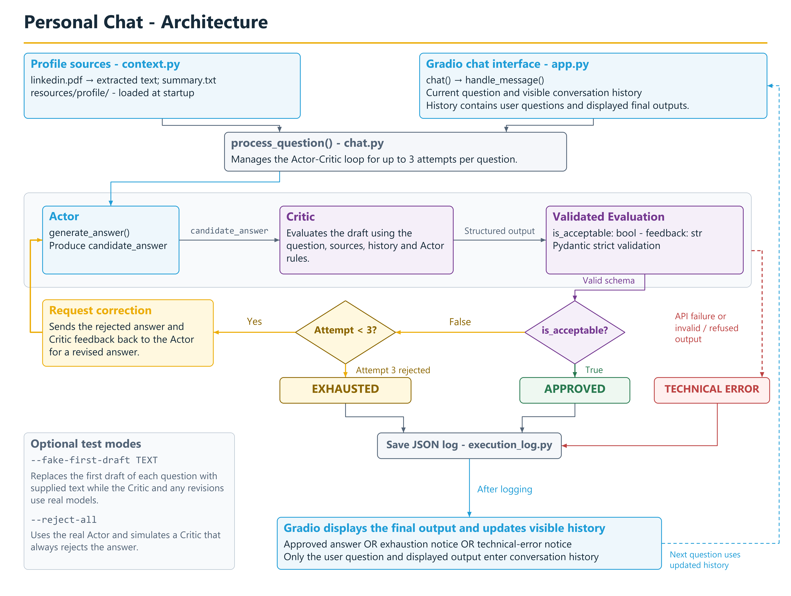

# Personal Actor Critic Chat

צ׳אט אישי המבוסס על הפרופיל של Ed Donner שראינו בהרצאה. יוצר התשובות (Actor) נעזר במקורות הרקע ובהיסטוריית השיחה, ומעריך נפרד (Critic) בודק כל תשובה ומחזיר החלטה ומשוב במבנה המאומת באמצעות Pydantic.

## דרישות

- גרסת Python 3.12 ומעלה. ההרצה בוצעה עם Python 3.12.12.
- מנהל החבילות `uv`.
- דרוש OpenAI API Key עם גישה למודלים המוגדרים.

## התקנת התלויות והגדרת הסביבה

יש לפתוח PowerShell בתיקיית הפרויקט ולהריץ:

```powershell
uv sync
if (-not (Test-Path .env)) { Copy-Item .env.example .env }
```

הפקודה `uv sync` יוצרת סביבה וירטואלית מקומית (`.venv`) ומתקינה את התלויות המוגדרות ב-`pyproject.toml`, בהתאם לקובץ `uv.lock`.

יש לערוך את `.env` ולהגדיר:

```dotenv
OPENAI_API_KEY=your_api_key_here
ACTOR_MODEL=gpt-5.4-mini
CRITIC_MODEL=gpt-6.1-terra
```

אלה שמות המודלים ששימשו בהרצות עם שני מודלי שפה בניסוי. אם אחד ממשתני המודל נשאר ריק, ברירת המחדל שלו היא `gpt-5.4-mini`.

מקורות הרקע צריכים להימצא בנתיבים הבאים:

- `resources/profile/linkedin.pdf`
- `resources/profile/summary.txt`

המקורות נטענים בתחילת ההפעלה. הטקסט מחולץ מכל עמודי ה-PDF.

## הפעלת הצ׳אט

```powershell
uv run python app.py
```

יש לפתוח בדפדפן את הכתובת המקומית שמודפסת בטרמינל ולהקליד שאלה. לעצירת השרת יש ללחוץ `Ctrl+C`. לאחר שינוי קבצי הרקע או ההגדרות יש להפעיל מחדש את האפליקציה.

### תרחיש 4 - טיוטה ראשונה פגומה

```powershell
uv run python app.py --fake-first-draft "Your faulty draft text here"
```

הטקסט שסופק מחליף את הטיוטה הראשונה בכל שאלה. המעריך בודק אותו באמצעות מודל שפה, ואם הוא נדחה, היוצר מתקן אותו באמצעות מודל שפה.

### תרחיש 5 - מיצוי ניסיונות

```powershell
uv run python app.py --reject-all
```

היוצר פועל באמצעות מודל השפה המוגדר, והמעריך מדומה ומחזיר דחייה בכל ניסיון. לאחר שלוש דחיות מוצגת הודעת מיצוי ניסיונות. זהו תרחיש לבחינת זרימת הבקרה, וההערכות בו אינן מתקבלות ממודל שפה.

ללא ארגומנטים הצ׳אט פועל כרגיל. שני המצבים מסומנים בממשק וביומני ה-JSON ואינם ניתנים להפעלה יחד.

הממשק באנגלית, באישור המרצה. התשובות באנגלית כברירת מחדל, ובשפת השאלה כאשר המשתמש שואל בשפה אחרת או מבקש שפה מסוימת. משוב המעריך נכתב באנגלית.

## המודלים וההגדרות ששימשו בניסוי

| תפקיד | מודל |
| --- | --- |
| Actor - יצירת תשובות ותיקונן | `gpt-5.4-mini` |
| Critic - הערכת התשובות | `gpt-6.1-terra` |

- עד שלושה ניסיונות לכל שאלה, כולל הטיוטה הראשונה. כל טיוטה נשלחת להערכה נפרדת, ומונה הניסיונות מתאפס בכל שאלה חדשה.
- המעריך בודק ביסוס במקורות, רלוונטיות, טיפול במידע חסר ובהירות. הוא מחזיר `is_acceptable: bool` ו-`feedback: str`, המאומתים באמצעות Pydantic.
- לאחר דחייה, היוצר מקבל את הטיוטה האחרונה שנדחתה ואת המשוב האחרון לצורך תיקון, יחד עם הרקע, השאלה והיסטוריית השיחה.
- מגבלת זמן של 60 שניות לכל בקשת API, ללא ניסיונות חוזרים אוטומטיים של ה-SDK. ניסיונות התיקון מנוהלים בלולאת היוצר והמעריך.
- היסטוריית השיחה המוצגת בצ׳אט כוללת רק את שאלות המשתמש ואת התשובות שהוחזרו אליו, ללא טיוטות שנדחו או משוב המעריך.

תשובה שאושרה מוצגת בצ׳אט. לאחר שלוש דחיות מוצגת הודעה שלא התקבלה תשובה מאושרת. כשל API או פלט הערכה שאינו תקין עוצרים את הטיפול ומציגים הודעת שגיאה טכנית. אישור המעריך ואימות המבנה אינם מבטיחים נכונות עובדתית.

לכל שאלה נשמר קובץ JSON מקומי בתיקיית `logs/`, הכולל את השאלה, ההיסטוריה, המודלים, הטיוטות, ההערכות והפלט שהוצג.

תיקיית `scenarios/` מכילה את תוצאות חמשת תרחישי המטלה, בתיקייה נפרדת לכל תרחיש. בכל תיקייה נמצאים צילומי מסך של הצ׳אט ויומני JSON המתעדים את השאלות, ניסיונות התשובה, ההחלטות והמשוב. בתרחיש 4 הטיוטה הראשונה מוזרקת, וההערכה והתיקון מתבצעים באמצעות מודלי שפה. בתרחיש 5 נעשה שימוש במעריך מדומה לבחינת מיצוי הניסיונות.

## ארכיטקטורה


